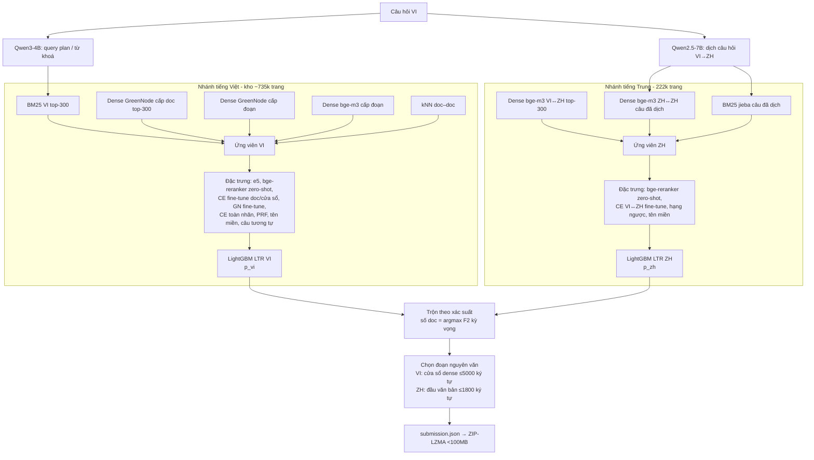

# Tài liệu thuyết minh sản phẩm – R2AI 2026 Stage 3 (ViBioMIR)

**Đội:** aichickenteam  
**Bài toán:** với mỗi câu hỏi y khoa tiếng Việt, trả về danh sách tài liệu (`relevant_docs`) và đoạn trích nguyên văn (`relevant_chunks`) từ kho đa ngôn ngữ VI / ZH / EN của BTC. Điểm = trung bình F2-macro cấp tài liệu và F2-macro cấp đoạn.  
**Bài nộp private:** `submissions/private/P7_v76b.zip` (submission ID 7924, phase 45).  
**Điểm public tương ứng:** 0.4077 theo luật chấm đoạn mới (BTC cập nhật 23/10/2026); cùng hệ thống trước khi đổi luật đạt 0.4488 (v75).

Mục lục: [1.1 Tổng quan hệ thống](#11-tổng-quan-hệ-thống) · [1.2 Dữ liệu](#12-tài-liệu-mô-tả-dữ-liệu) · [1.3 Mô hình](#13-mô-hình-sử-dụng) · [1.4 Mã nguồn](#14-mã-nguồn) · [1.5 Hướng dẫn](#15-tài-liệu-hướng-dẫn) · [Khai báo nguồn nhãn](#khai-báo-về-nguồn-nhãn-huấn-luyện)

---

## 1.1 Tổng quan hệ thống

### Ý tưởng chính

Hệ thống là pipeline **truy hồi nhiều nguồn → xếp hạng lại bằng học máy (learning-to-rank) → chọn số lượng kết quả tối ưu F2**, gồm hai nhánh:

1. **Nhánh tiếng Việt (VI)** – kho ~735k trang VI do đội tự thu thập từ danh sách URL của BTC.
   - Ứng viên: BM25 (top-300) ∪ dense GreenNode cấp tài liệu (top-300) ∪ dense GreenNode cấp đoạn ∪ dense bge-m3 cấp đoạn ∪ mở rộng láng giềng tài liệu (kNN).
   - Xếp hạng: LightGBM (LTR) trên ~60 đặc trưng: điểm BM25, các điểm dense, cross-encoder (zero-shot và fine-tune), độ tương đồng với nhóm tài liệu đầu (PRF), tiên nghiệm tên miền, đặc trưng “tài liệu đúng của câu hỏi tương tự”.
2. **Nhánh tiếng Trung (ZH)** – bộ 235.518 URL ZH trong `links_corpus_vi_en_zh.parquet` (BTC cập nhật 12/10); đội thu thập được 222.297 trang.
   - Câu hỏi VI được **dịch sang tiếng Trung** bằng Qwen2.5-7B-Instruct (gợi ý *Query Translation* tại Mentor Day 3).
   - Ứng viên: dense đa ngôn ngữ bge-m3 (câu VI ↔ doc ZH) ∪ dense ZH–ZH (câu đã dịch) ∪ BM25 tiếng Trung (jieba) trên câu đã dịch.
   - Xếp hạng: LightGBM riêng cho ZH với các đặc trưng dense, BM25, cross-encoder bge-reranker-v2-m3 (zero-shot và fine-tune cho cặp VI↔ZH), hạng ngược (câu hỏi đứng thứ mấy trong 1200 câu đối với tài liệu), tiên nghiệm tên miền.
3. **Trộn hai nhánh theo xác suất**: mọi tài liệu VI và ZH được gộp chung theo xác suất liên quan (đã hiệu chỉnh), số tài liệu mỗi câu = argmax F2 kỳ vọng.
4. **Chọn đoạn**: mỗi tài liệu được chọn kèm một đoạn trích nguyên văn: VI là cửa sổ ~1600 ký tự khớp ngữ nghĩa nhất (dense cấp đoạn), nới tối đa 5000 ký tự; ZH là phần đầu văn bản, tối đa 1800 ký tự. Tối đa 250 đoạn/câu (giới hạn file nộp < 100MB, nén ZIP-LZMA).

Tiếng Anh (PubMed): đội đã thu thập 239.770 abstract và thử truy hồi (bge-m3). Hai lần thăm dò (doc_id nội bộ và PMID) đều cho 0 kết quả đúng trên tập public, nên bài nộp cuối không chứa tài liệu EN.

### Sơ đồ luồng xử lý



Bản ASCII rút gọn:

```
câu hỏi VI ─┬─ BM25 VI ─┐                                   ┌─ LTR VI (LightGBM) ─┐
            ├─ dense GN doc / GN đoạn / bge-m3 đoạn / kNN ─┤                      ├─ trộn theo p ─ chọn đoạn ─ zip
            └─ dịch ZH (Qwen2.5-7B) ─ BM25 ZH + dense ZH/VI↔ZH ─ LTR ZH (LightGBM) ┘
```

### Xây dựng chỉ mục, truy hồi, xếp hạng lại, chọn đầu ra

| Bước | Cách làm | Mã nguồn |
|---|---|---|
| Thu thập & làm sạch | crawler bất đồng bộ (curl_cffi giả Chrome, xử lý GBK/GB18030, lưu trạng thái sqlite để chạy tiếp), trích nội dung chính bằng bộ trích riêng cho các trang lớn + trafilatura | `src/crawl.py`, `src/extractors/`, `scripts/pharmacity_fetch.py`, `scripts/fetch_39m.py`, `kaggle_zhcrawl/` |
| Chỉ mục BM25 VI | âm tiết + bigram, index cục bộ (`indexes/`, `data/cache/bm25_vi`) | `src/index.py`, `scripts/pipeline_v2.py` |
| Chỉ mục dense VI | GreenNode-Embedding-Large-VN: doc = tiêu đề + 1500 ký tự đầu; tìm kiếm chính xác (exact inner product, ma trận trên GPU, 1024-d fp16) | `scripts/dense_vi.py` |
| Dense cấp đoạn VI | cửa sổ ~1600 ký tự (≤6 cửa sổ/doc), GreenNode và bge-m3, lấy điểm cửa sổ tốt nhất | `kaggle/dense_chunks.py`, `kaggle_bgem3/`, `scripts/dense_chunks_add.py` |
| kNN doc–doc | láng giềng GreenNode của top-40 doc → thêm ứng viên ngoài pool | `scripts/doc_knn.py`, `scripts/knn_expand.py`, `kaggle_knnpairs/`, `scripts/knn_merge.py` |
| Cross-encoder | bge-reranker-v2-m3 zero-shot; fine-tune 5 fold theo câu (đánh giá OOF trung thực) trên doc và trên cửa sổ | `kaggle_ft/`, `kaggle_cewin_*`, `kaggle_ce2b/`, `scripts/ce2_prep.py` |
| LTR VI | LightGBM nhị phân, 5 fold theo câu, bagging 5 seed, xác suất OOF cho câu có nhãn | `scripts/ltr.py`, `kaggle_ltrx/` |
| ZH | dense bge-m3, CE zero-shot + fine-tune VI↔ZH, dịch câu hỏi, BM25 jieba, LTR riêng | `kaggle_zhfeat/`, `kaggle_qtrans/`, `scripts/zh_qfeat.py`, `scripts/cezh_prep.py`, `kaggle_cezh/`, `scripts/zh_ltr3.py` |
| Chọn đầu ra | số doc/câu = argmax_n 5·Σp₁..ₙ / (4·c·Σp + n), c = 1.9 (tối ưu F2 kỳ vọng); trộn VI+ZH theo p (p_zh × 0.9) | `scripts/fuse_dense.py`, `scripts/merge_zh.py` |
| Đóng gói | JSON → ZIP-LZMA (từ điển 1GB, sắp xếp các câu có đoạn trùng cạnh nhau) để < 100MB | `scripts/zip_lzma.py` |

---

## 1.2 Tài liệu mô tả dữ liệu

### Nguồn

| Dữ liệu | Nguồn | Quy mô | Ghi chú |
|---|---|---|---|
| Danh sách URL & câu hỏi | HF `AIGuruTinix/ViBioMIR` (`links_corpus.parquet`, `links_corpus_vi_en_zh.parquet`, `query.parquet`) | 1200 câu, 4.39M URL (bản cũ), 1.22M URL (bản 12/10) | do BTC cung cấp |
| Trang VI | tự thu thập từ URL VI của BTC | **735.361 trang** có nội dung (`data/docs/corpus-*.parquet`) | gồm 5.324 trang Pharmacity lấy lại qua `www.pharmacity.vn/<slug>.htm` theo hướng dẫn BTC 19/10, **giữ nguyên doc_id gốc** |
| Trang ZH | tự thu thập bộ 235.518 URL ZH của bản 12/10 | **222.297 trang** (`zh_docs.parquet`) | 120ask/39.net chặn IP Việt Nam → cào từ Kaggle; 39.net dùng bản mobile `m.39.net/<mục>/a_<id>.html` (giữ doc_id gốc); zysjonline (6.6k) bị chặn hoàn toàn |
| Abstract PubMed (EN) | NCBI E-utilities theo PMID trong file BTC | 239.770 abstract | không dùng trong bài nộp cuối (0 kết quả đúng trên public) |

Không dùng dữ liệu y khoa ngoài nào khác.

### Thu thập, làm sạch, phân đoạn

- **Thu thập:** `python -m src.crawl --ids-file <ids> --lang vi|zh --per-domain N --delay S` (lịch sự theo tên miền, có thể chạy tiếp sau khi dừng). Các đợt cào song song trên Kaggle dùng `kaggle_crawl*/`, `kaggle_zhcrawl/` (mỗi shard một IP).
- **Làm sạch:** bỏ script/style/menu; bộ trích riêng cho các trang lớn (`src/extractors/sites.py`: 120ask, 39.net, cnkang, Long Châu, Vinmec, …); với trang còn lại dùng trafilatura + mật độ văn bản; chuẩn hoá khoảng trắng, giữ ranh giới đoạn (mỗi khối một dòng). Pharmacity: lấy `#pmc-content-blog-detail`, ranh giới thẻ khối/`<strong>` → xuống dòng (tránh dính chữ).
- **Phân đoạn:** cửa sổ ~1600 ký tự theo ranh giới câu, tối đa 6 cửa sổ/doc (`scripts/chunk_v2.py`, `kaggle/dense_chunks.py`); đoạn nộp = cửa sổ khớp nhất được nới về sau tới 5000 ký tự (VI), hoặc 1800 ký tự đầu (ZH). Mọi đoạn là **trích nguyên văn** từ văn bản đã thu thập.

### Truy cập dữ liệu

Toàn bộ dữ liệu và các kết quả trung gian được chia sẻ tại thư mục Google Drive:

> **[ĐIỀN LINK GOOGLE DRIVE]** (quyền xem cho bất kỳ ai có link)

| Tệp trên Drive | Nội dung | Kích thước |
|---|---|---|
| `vi_docs.tar` | `data/docs/corpus-*.parquet` – 735k trang VI (doc_id, source, lang, url, title, text, fetched_at) | ~1.0 GB |
| `zh_docs.parquet` | 222k trang ZH (doc_id, lang, url, title, text) | ~0.27 GB |
| `artifacts_final.tar` | kết quả trung gian để tái hiện nhanh bài nộp cuối (xem README §Tái hiện nhanh) | ~2.4 GB |
| `submission_private_P7_v76b.zip` | file đã nộp private (ID 7924) | 93 MB |

Tệp `artifacts_final.tar` được tạo bằng `bash scripts/package_release.sh`.

---

## 1.3 Mô hình sử dụng

Tất cả đều là mô hình mã nguồn mở (trọng số công khai), ≤ 15B tham số, phát hành trước 01/08/2026. Không dùng LLM đóng hay API trả phí.

| Vai trò | Mô hình (định danh HF) | Tham số | Phát hành | Dùng ở |
|---|---|---|---|---|
| Embedding VI (dense doc & đoạn; fine-tune bi-encoder) | `GreenNode/GreenNode-Embedding-Large-VN-Mixed-V1` (MIT) | 568M | 04/2025 | `scripts/dense_vi.py`, `scripts/rerank_vi.py`, `kaggle_gnft_*` |
| Embedding đa ngôn ngữ (VI đoạn, VI↔ZH, ZH↔ZH) | `BAAI/bge-m3` (MIT) | 568M | 01/2024 | `kaggle_bgem3/`, `kaggle_zhfeat/`, `scripts/zh_qfeat.py` |
| Embedding phụ (đặc trưng LTR) | `intfloat/multilingual-e5-large-instruct` (MIT) | 560M | 02/2024 | `colab/encode_e5.py` |
| Cross-encoder (zero-shot + fine-tune) | `BAAI/bge-reranker-v2-m3` (Apache-2.0) | 568M | 03/2024 | `colab/rerank_bge.py`, `kaggle_ft/`, `kaggle_cewin_*`, `kaggle_ce2b/`, `kaggle_cezh/` |
| Dịch câu hỏi VI→ZH | `Qwen/Qwen2.5-7B-Instruct` (Apache-2.0) | 7.6B | 09/2024 | `kaggle_qtrans/qtrans.py` |
| Phân tích câu hỏi (query plan, từ khoá) | `Qwen/Qwen3-4B-Instruct-2507` (Apache-2.0; bản 4-bit `unsloth/Qwen3-4B-Instruct-2507-bnb-4bit`) | 4.0B | 08/2025 | `src/llm.py`, `src/query.py` |
| Xếp hạng | LightGBM 4.7 (không phải mạng nơ-ron) | – | – | `scripts/ltr.py`, `scripts/zh_ltr3.py` |

**Checkpoint:** các mô hình gốc tải trực tiếp từ Hugging Face theo định danh trên (`huggingface-cli download <id>` hoặc tự tải khi gọi `from_pretrained`). Các mô hình fine-tune (cross-encoder 5 fold và bản toàn nhãn, GreenNode fine-tune) được huấn luyện lại bằng các kernel Kaggle trong repo (T4×2, 3–6 giờ/kernel; tham số ghi ở đầu mỗi file). Điểm số OOF của chúng được lưu sẵn trong `artifacts_final.tar`, nên không cần huấn luyện lại để tái hiện bài nộp.

**Prompt dịch câu hỏi** (Qwen2.5-7B-Instruct, greedy, `repetition_penalty=1.05`):

> System: 你是专业的医学翻译。把用户给出的越南语医学问题准确翻译成简体中文，保留所有症状、疾病、药物、检查名称等医学术语的准确含义，不要回答问题，不要添加解释，只输出译文。  
> User: `<câu hỏi tiếng Việt>`

---

## 1.4 Mã nguồn

Toàn bộ mã trong repo (Git). Danh sách các thành phần chính theo thứ tự chạy:

| Giai đoạn | Tệp |
|---|---|
| Thu thập | `src/crawl.py`, `src/extractors/*`, `configs/default.yaml`, `kaggle_crawl*/`, `kaggle_zhcrawl/`, `scripts/pharmacity_fetch.py`, `scripts/fetch_39m.py`, `scripts/refetch_missing.py`, `scripts/pubmed_fetch_links.py` |
| Hiểu câu hỏi | `src/llm.py`, `src/query.py` (→ `data/cache/query_plans.jsonl`), `kaggle_qtrans/qtrans.py` (→ `q_zh.json`) |
| BM25 + ứng viên VI | `src/index.py`, `scripts/pipeline_v2.py` (→ `vi_preds_300.jsonl`), `scripts/rerank_vi.py` (→ `rr_gn_top200.npy`) |
| Dense VI | `scripts/dense_vi.py`, `kaggle/dense_chunks.py`, `kaggle_bgem3/`, `scripts/dense_chunks_add.py`, `colab/encode_e5.py` |
| Doc mới (gộp vào cache) | `scripts/newdocs_prep.py`, `kaggle_newdocs/`, `scripts/newdocs_filter.py`, `scripts/newdocs_merge.py` |
| kNN | `scripts/doc_knn.py`, `scripts/knn_expand.py`, `kaggle_knnpairs/`, `scripts/knn_merge.py` |
| Cross-encoder / fine-tune | `colab/rerank_bge.py`, `colab/rerank_win.py`, `colab/ft_ce.py`, `kaggle_ft/`, `kaggle_cewin_*/`, `kaggle_gnft_*/`, `kaggle_savemodels/`, `scripts/ce2_prep.py`, `kaggle_ce2b/` |
| LTR VI | `scripts/ltr.py`, `kaggle_ltrx/` (chạy LTR trên Kaggle CPU từ ma trận đặc trưng) |
| ZH | `kaggle_zhfeat/`, `scripts/zh_qfeat.py`, `scripts/cezh_prep.py`, `kaggle_cezh/`, `scripts/zh_ltr3.py` |
| Tạo bài nộp | `scripts/fuse_dense.py`, `scripts/merge_zh.py`, `scripts/zip_lzma.py`, `kaggle_buildzip/` (cùng quy trình trên Kaggle) |
| Nộp bài | `scripts/submit_api.py`, `scripts/private_submit.sh` |
| Đánh giá offline | `scripts/f2sim.py`, `scripts/eval_models.py` |

**Phụ thuộc** (`requirements.txt`, Python 3.12): torch 2.5.1 (CUDA 12.1), transformers 5.18, sentence-transformers 5.7, lightgbm 4.7, scikit-learn 1.9, numpy 2.5, pandas 3.0, pyarrow 25, bm25s 0.3.11, jieba 0.42.1, pyvi 0.1.1, curl_cffi 0.16.3, trafilatura 2.2, selectolax 0.4.13, ijson 3.6, faiss-cpu 1.15, kaggle 2.2.4. Kernel Kaggle: image Python mặc định của Kaggle + các gói cài trong đầu mỗi script.

**Cấu hình:** `configs/default.yaml` (crawler); tham số LTR `R2AI_LTR_PARAMS='{"learning_rate":0.03,"lambda_l2":10,"min_data_in_leaf":50}'`, 700 vòng, 5 seed; tham số trộn/đóng gói của bài cuối ghi trong README §Tái hiện nhanh.

---

## 1.5 Tài liệu hướng dẫn

Xem **[README.md](../README.md)**: yêu cầu môi trường, tải dữ liệu/checkpoint, tái hiện nhanh bài nộp từ kết quả trung gian (~1 giờ CPU), và tái hiện đầy đủ từ đầu.

---

## Khai báo về nguồn nhãn huấn luyện

Để minh bạch theo thông báo của BTC ngày 23/10/2026:

- BTC không cung cấp tập huấn luyện có nhãn. Nhãn liên quan (câu hỏi, tài liệu) dùng để huấn luyện LTR và fine-tune cross-encoder được lấy từ **tệp `details.jsonl` mà hệ thống chấm trả về sau mỗi lần nộp public**: tệp này cho biết đoạn nào trong bài nộp được tính là khớp. Tổng cộng ~363k cặp đã gán nhãn, khoảng 32k cặp dương. Đội cũng nộp một số bài **thăm dò** chỉ gồm các tài liệu chưa có nhãn để lấy thêm nhãn (`experiments.csv`: v60, v63, v66, v69, v72-probe).
- Đội **không** chép đáp án dò được vào bài nộp. Mọi xác suất cho câu public đều là **out-of-fold** (5 fold theo câu: mô hình chấm một câu không thấy nhãn của chính câu đó), nên điểm public phản ánh khả năng tổng quát hoá. Câu private không có nhãn nào và được chấm bằng mô hình huấn luyện trên toàn bộ nhãn public.
- Từ 22/10, sau khi BTC tắt thông tin chi tiết, đội không thu thêm nhãn. Lịch sử đầy đủ có trong `experiments.csv`, `HANDOFF.md` và git log.
