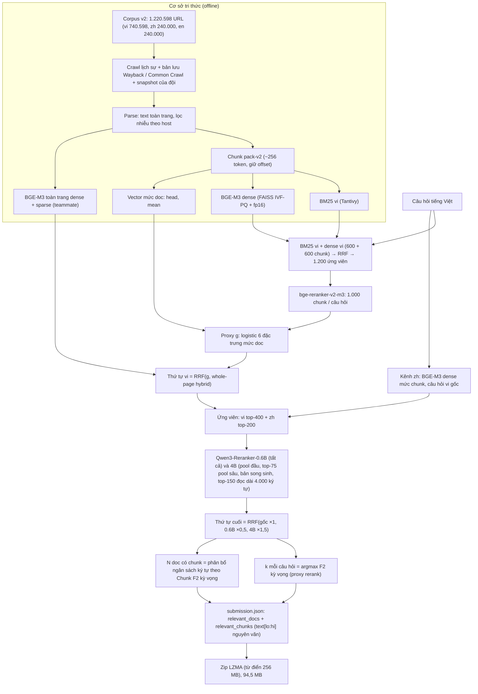

# Thuyết minh sản phẩm: hệ thống truy hồi y sinh ViBioMIR (bài nộp S11)

ROAD TO AI 2026, Stage 3. Bài được mô tả: `sub-long-kproxy-nproxy-v1` (S11).

| | Doc F2 | Chunk F2 | Final |
|---|---|---|---|
| Public LB | 0,4094 | 0,3376 | **0,3735** |

Bài này cũng là lượt nộp đầu tiên ở vòng private.

Cách cài đặt và chạy lại xem [README.md](../README.md). Tài liệu này trả lời các mục 1.1–1.4 trong hướng dẫn của BTC.

| Mục của BTC | Phần trong tài liệu |
|---|---|
| 1.1 Tổng quan hệ thống | §1 |
| 1.2 Tài liệu mô tả dữ liệu | §2 |
| 1.3 Mô hình sử dụng | §3 |
| 1.4 Mã nguồn | §4, README §6 |
| 1.5 Tài liệu hướng dẫn | README |

---

## 1. Tổng quan hệ thống

### 1.1 Phương pháp

Hệ thống là một pipeline truy hồi nhiều tầng, không dùng mô hình sinh văn bản:

1. **Cơ sở tri thức.**
   - **Thu thập:** đội tự crawl nội dung các URL của corpus v2.
   - **Xử lý:** trích text toàn trang và lọc nhiễu theo từng site.
   - **Phân đoạn và chỉ mục:** chia đoạn giữ nguyên offset trên text gốc, rồi lập chỉ mục BM25 (Tantivy) và chỉ mục dense BGE-M3 (FAISS).
2. **Truy hồi ứng viên.** Câu hỏi tiếng Việt được tìm qua nhiều kênh:
   - BM25 và dense ở mức chunk, gộp RRF, sau đó bge-reranker-v2-m3 chấm lại 1.000 chunk;
   - dense ở mức doc (đoạn đầu trang, trung bình các đoạn);
   - dense + sparse trên toàn trang (BGE-M3);
   - riêng tiếng Trung: dense BGE-M3 mức chunk với chính câu hỏi tiếng Việt (BGE-M3 đa ngôn ngữ).
3. **Xếp hạng lại mức doc.** Qwen3-Reranker-0.6B và -4B (cross-encoder) đọc trang của từng ứng viên vi và zh. Thứ tự cuối là RRF có trọng số của thứ tự gốc và hai thứ hạng rerank.
4. **Chọn kết quả.**
   - **Số doc nộp mỗi câu hỏi (k):** chọn để F2 kỳ vọng lớn nhất. Xác suất một doc là gold được ước lượng bằng một mô hình logistic nhỏ.
   - **Fit mô hình:** mô hình được fit vào precision/recall mà leaderboard trả về cho các bài đã nộp trước đó (learning from label proportions).
   - **Chunk:** mỗi doc được chọn nộp một đoạn **cắt nguyên văn** từ text của trang, đặt quanh đoạn mà reranker chấm cao nhất.
   - **Số doc có chunk (N):** chọn theo mức tăng Chunk F2 kỳ vọng trên mỗi ký tự, trong một ngân sách ký tự cố định để file nộp không vượt 100 MB.

### 1.2 Sơ đồ



Bản chữ của sơ đồ, cho trình xem không hiển thị được mermaid:

```
câu hỏi vi ─┬─ BM25 vi + BGE-M3 dense (chunk) ─ RRF ─ bge-reranker-v2-m3 (1.000 chunk) ─┐
            │                                                                          ├─ proxy g ─ RRF với whole-page ─ thứ tự vi
            └─ BGE-M3 whole-page dense + sparse ───────────────────────────────────────┘
            zh: BGE-M3 dense mức chunk, câu hỏi tiếng Việt gốc
                      │
 ứng viên: vi top-400 + zh top-200 ─ Qwen3-Reranker-0.6B (tất cả) + 4B (vi top-200, zh top-100, top-75 phần sâu,
                                     doc song sinh, top-150 đọc 4.000 ký tự)
                      │
 thứ tự cuối = RRF(vị trí trong danh sách gốc ×1, hạng 0.6B ×0,5, hạng 4B ×1,5)
 k mỗi câu hỏi = argmax F2 kỳ vọng theo proxy rerank
 chunk = đi theo thứ tự cuối; N_q doc đầu có text nhận một đoạn nguyên văn ≤ 7.000 ký tự (zh ≤ 2.000)
```

### 1.3 Luồng xử lý một câu hỏi

Dưới đây là từng bước, từ câu hỏi đến danh sách doc và đoạn trả về. Số liệu là trung bình trên 1.200 câu hỏi.

1. **Truy hồi chunk tiếng Việt** (`medret run`, run `pool-vi-m1000`).
   - BM25 trên chỉ mục vi và BGE-M3 dense (câu hỏi không có instruction) lấy mỗi kênh 600 chunk.
   - Gộp RRF (k = 60) còn 1.200 ứng viên. bge-reranker-v2-m3 chấm 1.000 chunk đầu theo cặp (câu hỏi, "tiêu đề + mục + đoạn").
2. **Đặc trưng mức doc.** Với mỗi doc vi trong tập ứng viên (các doc của pool chunk, cộng top-300 theo vector đầu trang):
   - `head_rel`, `mean_rel`: cosine BGE-M3 giữa câu hỏi và vector đầu trang / vector trung bình, trừ đi cosine cao nhất của câu hỏi đó;
   - `dense_rr`, `bm25_rr`: 60 / (60 + hạng tốt nhất của doc) trong từng kênh chunk;
   - `rerank`: điểm bge-reranker cao nhất của doc, kèm cờ `in_rerank`.
3. **Proxy g.**
   - **Mô hình:** P(doc là gold) = sigmoid(w · đặc trưng).
   - **Fit:** khớp tỷ lệ gold mà leaderboard báo cho 26 tập doc đã nộp. Mỗi bài nộp cho P và R của cả tập, tức là một "nhãn tổng hợp" (learning from label proportions).
   - **Đầu ra:** thứ tự doc theo g.
4. **Thứ tự vi.** RRF (k = 60) của thứ tự g và kênh whole-page hybrid (dense + 0,3 × sparse của BGE-M3 trên toàn trang). k và N của danh sách này cũng được chọn theo g, cho ra danh sách `sub-vi-rrfwp-win2x10-v1`.
5. **Thêm tiếng Trung.**
   - **Danh sách gốc:** cộng 30 doc zh đầu theo thứ hạng BGE-M3 mức chunk của kênh zh, được `sub-vi-rrfwp-zh30docs-v1` (194 doc mỗi câu hỏi).
   - **Ngân sách chunk của S11:** lấy từ bài có thêm chunk cho 25 doc zh đầu (`sub-vi-rrfwp-zh30c25snap-v1`).
6. **Rerank mức doc (Kaggle, 2 × T4, fp16).**
   - **Ứng viên mỗi câu hỏi:** vi top-200 + zh top-100 (pool đầu) và vi hạng 200–399 + zh hạng 100–199 (pool sâu).
   - **Qwen3-Reranker-0.6B:** chấm toàn bộ 720.000 cặp.
   - **Qwen3-Reranker-4B:** chấm pool đầu (360.000 cặp) và 75 cặp tốt nhất theo 0.6B của pool sâu (90.000).
   - **Doc song sinh:** 81.000 doc zh không có text dưới id của chúng (bản http/https của trang đã crawl dưới id chuẩn) được 4B chấm bằng text của id chuẩn.
   - **Đọc dài:** 150 doc đầu mỗi câu hỏi được 4B chấm lại với 4.000 ký tự / 1.024 token (thay cho 1.600 ký tự / 512 token).
   - **Đầu vào của reranker:** "tiêu đề trang + text trang", cắt theo số ký tự trên.
7. **Thứ tự cuối.** Điểm của mỗi doc = 1/(61 + vị trí trong danh sách gốc) + 0,5/(61 + hạng theo 0.6B) + 1,5/(61 + hạng theo 4B).
   - Hạng rerank tính trên các ứng viên có text, chung cho cả vi và zh.
   - Doc không có text giữ vị trí gốc thay cho hạng rerank.
8. **Số doc nộp (k).** Proxy rerank cho mỗi doc ứng viên p = sigmoid(b0 + b1·logit(4B) + b2·logit(0.6B) + b3·[zh] + b4·[không text] + b5·log(1+hạng gốc vi) + b6·log(1+hạng gốc zh) + b7·[pool sâu]).
   - Số gold của câu hỏi ước lượng bằng Σp / (1 − f), trong đó f là phần gold nằm ngoài tập ứng viên, fit được f ≈ 25%.
   - Tham số được fit vào doc P/R trên leaderboard của 8 bài trước S11 (sai số ≤ 0,004).
   - Với mỗi câu hỏi chọn k ∈ {10, 15, …} cho F2 kỳ vọng lớn nhất: k trung bình 151, từ 10 đến 385 (F2 kỳ vọng 0,4215 → 0,4470).
9. **Chunk.**
   - **Phân bổ N_q:** tổng ngân sách 699 triệu ký tự được chia cho các câu hỏi theo mức tăng Chunk F2 kỳ vọng trên mỗi ký tự, dùng cùng p. N trung bình 134.
   - **Chọn doc:** đi theo thứ tự cuối, N_q doc đầu có text, mỗi doc nhận một đoạn:
     - **doc vi:** cửa sổ ≤ 7.000 ký tự đặt quanh chunk mà bge-reranker chấm cao nhất. 10 doc vi đầu còn nhận thêm hai nửa của cửa sổ, cắt ở chỗ xuống dòng gần giữa nhất;
     - **doc zh:** 2.000 ký tự đầu trang (trang hỏi đáp, trung vị khoảng 700 ký tự);
     - **doc song sinh:** text của id chuẩn (cùng trang).
   - **Nguyên văn:** mọi `chunk_text` là `text[lo:hi]` của doc.
   - **Kết quả:** trung bình 153,6 chunk mỗi câu hỏi, trong đó 19,5 chunk zh.
10. **Đóng gói.** Các câu hỏi được sắp sao cho câu liền kề có nhiều doc chung. File nén LZMA với từ điển 256 MB còn 94,5 MB (giới hạn 100 MB).

### 1.4 Xây dựng chỉ mục

| Thành phần | Cách làm | Code |
|---|---|---|
| Kho metadata | DuckDB: bảng `documents` (doc_id, url, host, lang, title, text, n_chars), `chunks` (offset start/end, heading_path, input_id), `aliases` (URL trùng) | `medret.index.meta` |
| Phạm vi | Chỉ các doc thuộc corpus v2 (1.115.382 doc, 4.092.295 input embedding) | `medret.index.scope` |
| BM25 | Tantivy, mỗi ngôn ngữ một chỉ mục. Term = âm tiết tiếng Việt + bigram âm tiết (tách trong Python); bỏ term có df > 10% khi truy vấn | `medret.index.lexical` |
| Dense | BGE-M3. Input passage = "tiêu đề · đường dẫn mục · đoạn", tối đa 1.024 token; CLS + chuẩn hóa L2. 8.148.135 vector fp16 (memmap) cho bước chấm chính xác, FAISS IVF8192,PQ64 (nprobe 64, 1.000 ứng viên thô) | `medret.index.dense`, `scripts/kaggle/embed_runner` |
| Vector mức doc | head = vector của chunk đầu (tiêu đề + mở bài); mean = trung bình chuẩn hóa các vector chunk | `scripts/analysis/doc_vectors.py` |
| Whole-page | BGE-M3 dense + sparse của toàn trang (tối đa 8.192 token), do teammate tính trên text sạch của snapshot | `teammate/page_embeddings/` |

### 1.5 Đóng góp của từng thành phần (public LB)

| Bài | Thay đổi so với bài trước | Final |
|---|---|---|
| `sub-vi-rrfwp-zh30docs-v1` | Danh sách gốc: thứ tự vi theo proxy g + whole-page, cộng 30 doc zh (§1.3 bước 1–5) | 0,3345 |
| `sub-fuse3w-4bfull-v1` | Thứ tự gộp với Qwen3-Reranker 0.6B và 4B, chunk đi theo thứ tự mới | 0,3606 |
| S8 `sub-fuse3w-4bfull-kproxy-v1` | k mỗi câu hỏi theo proxy rerank | 0,3701 |
| S9 `sub-deep-kproxy-nproxy-v1` | Thêm pool sâu (vi 200–399, zh 100–199); N theo proxy rerank | 0,3708 |
| S10 `sub-twins-kproxy-nproxy-v1` | 4B đọc doc song sinh qua bản http/https của nó | 0,3724 |
| **S11** `sub-long-kproxy-nproxy-v1` | 4B đọc dài 4.000 ký tự cho top-150 | **0,3735** |

---

## 2. Dữ liệu

### 2.1 Nguồn dữ liệu

| Nguồn | Dùng cho | Truy cập | License / điều kiện |
|---|---|---|---|
| ViBioMIR (BTC): `query.parquet` (1.200 câu hỏi), `links_corpus_vi_en_zh.parquet` (corpus v2, tải 13/10/2026) | Câu hỏi, danh sách URL | https://huggingface.co/datasets/AIGuruTinix/ViBioMIR (`medret download`) | CC BY-NC 4.0 |
| Nội dung trang tải trực tiếp từ URL của corpus | Text của 688.684 doc v2 | Crawler của đội (`crawler/`) | Nội dung thuộc các website; chỉ dùng cho cuộc thi, không phân phối công khai |
| Internet Archive Wayback Machine: bản lưu của **chính URL** trong corpus | Text của 73.023 doc v2 mà site gốc chặn, lỗi 5xx hoặc đã gỡ | https://web.archive.org (cột `detail = archive:wb:<timestamp>` trong manifest) | Như trên |
| Common Crawl: bản lưu của **chính URL** trong corpus | Text của 36.651 doc v2 | https://commoncrawl.org (`detail = archive:cc:<crawl>`) | Như trên |
| Trang render bằng trình duyệt headless (trang cần JavaScript) | 4.041 doc v2 | `detail = browser` | Như trên |
| Snapshot crawl của đội (thành viên GloryVu: cùng các URL, text toàn trang đã làm sạch) | Text của 41.240 doc vi (bản 19/10) và 97.094 doc zh (bản 23/10) mà crawl của mình chưa có; quan hệ trùng URL http/https; vector whole-page | Kaggle private `gloryvu/vibiomir-crawl-snapshot`, `gloryvu/vibiomir-bgem3-pages(-b)`; có trong gói dữ liệu B | Dữ liệu nội bộ của đội |
| PubMed (NCBI E-utilities efetch) | 240.000 doc en của corpus v2, đã lập chỉ mục. **Không dùng trong S11**: gold public chỉ có doc vi và zh | https://eutils.ncbi.nlm.nih.gov | Tóm tắt thuộc NLM / nhà xuất bản |

- **Không có nguồn ngoài corpus:** đội không dùng nguồn nào ngoài các URL của corpus. Không dùng MedKB hay công cụ tìm kiếm nào để tra câu hỏi thi.
- **Bản lưu công khai:** chỉ dùng để lấy nội dung của chính các URL trong corpus khi không tải trực tiếp được.

### 2.2 Thu thập

- **Crawler** (`crawler/src/crawl/polite.py`, đội tự viết):
  - **Phân chia:** URL được chia đều cho nhiều máy, mỗi máy một IP và có phần của mọi site (`split_crawl_sets.py`).
  - **Giới hạn và quy tắc:** tối đa 1 request/giây mỗi site, tuân thủ robots.txt. Bị chặn thì nghỉ và lùi dần tới 30 phút; không vượt captcha.
  - **Lưu trữ:** lưu HTML thô, kèm trạng thái và nhãn lỗi, vào `data/crawl/pages/<site>/part-*.parquet`.
- **Manifest** (`medret manifest`): giữ một bản cho mỗi doc_id, ưu tiên lần tải thành công mới nhất. URL trùng sau khi chuẩn hóa (`medret.data.urls.canonical_key`: host, path đã giải mã và bỏ `/` cuối, tham số query đã sắp xếp và bỏ tham số theo dõi) dùng chung text qua `aliases.parquet`.
- **Độ phủ lúc dựng S11 (doc có text):**

| Ngôn ngữ | Corpus v2 | Có text | Ghi chú |
|---|---|---|---|
| vi | 740.598 | 735.256 (99,3%) | crawl của đội + 41.240 doc từ snapshot 19/10 |
| zh | 240.000 | khoảng 154.000 dưới chính id, cộng khoảng 82.000 id là bản http/https của trang đã crawl | 97.094 doc từ snapshot 23/10 |
| en | 240.000 | 239.949 | PubMed, không dùng trong S11 |

### 2.3 Làm sạch

Code: `medret.parse`, `medret templates`.

- **Trích text:** dùng resiliparse (`minimal_html`) trên toàn trang. Thuật toán `main_content` chỉ dùng để chọn khối, không dùng làm text: khi được dùng làm text, nó sửa nội dung ở 1,9% đoạn văn (28% số trang), khiến text không còn nguyên văn.
- **Lọc nhiễu:**
  - template học theo từng host trên một mẫu trang (dòng lặp lại trên nhiều trang của cùng site);
  - hộp "tin liên quan", dòng chỉ có link ngắn, đoạn teaser.
- **Chất lượng (đo trên 6.900 trang):** giữ 98% nội dung cần giữ; nhiễu còn 1,5%.
- **Text nộp bài:** text đã parse là nguồn duy nhất của `chunk_text`. Chuẩn hóa (NFC, chữ thường, bỏ dấu câu) chỉ dùng trong chỉ mục.

### 2.4 Phân đoạn

- **Chunk chỉ mục (pack-v2, `medret.chunk`):**
  - Section ngắn hơn 512 token được giữ nguyên, không bị cắt; các khối nhỏ được ghép tới khoảng 256 token.
  - Token đếm bằng tokenizer của BGE-M3. Mỗi chunk ghi offset `start/end` trên text của doc.
  - Corpus v2 có 4.057.381 chunk.
- **Đoạn nộp bài:**
  - **Cửa sổ:** độc lập với chunk chỉ mục, là cửa sổ ≤ 7.000 ký tự quanh chunk tốt nhất (§1.3 bước 9).
  - **Lý do:** BTC không giới hạn độ dài chunk. Luật khớp hiện hành (LCS ≥ 40% độ dài chunk gold và ≥ 40% độ dài chunk nộp) cho thấy chunk gold thường dài gần cả trang.

### 2.5 Gói dữ liệu chia sẻ

Mỗi gói giải nén vào `data/` của repo:

| Gói | Nội dung | Dung lượng | Link |
|---|---|---|---|
| A: tái lập S11 | Điểm Qwen3-Reranker của 7 lượt chạy Kaggle; 9 bài nộp trước S11 (danh sách gốc, ngân sách chunk, tập fit proxy); điểm bge-reranker của pool vi; `meta.duckdb` rút gọn (text của 272.196 doc cần dùng); text zh từ snapshot; quan hệ doc song sinh; bài S11 đã nộp để đối chiếu | 2,9 GB | [du-lieu-A.zip](https://drive.google.com/file/d/1I-w7_QmhkTSyslAHfA0WpJOTJfLV7ueI/view?usp=sharing) |
| B: dựng lại các bước trước | Doc đã parse (`data/parsed/documents`, 3,5 GB), chunk, manifest/aliases; snapshot 23/10 và vector whole-page của đội; bài probe zh; các kênh mức doc và proxy g đã đóng băng; ứng viên của pool vi | 7,6 GB | đã chuẩn bị (`du-lieu-B.zip`, 8,0 GB), gửi khi BTC yêu cầu |
| C (tùy chọn) | HTML gốc (11 GB); chỉ mục dense BGE-M3 (19 GB) và BM25 vi (1,7 GB). Dựng lại được từ B theo README §5 | 32 GB | cung cấp khi BTC yêu cầu |

- **Dữ liệu chính thức:** câu hỏi và danh sách URL không nằm trong các gói, tải bằng `medret download`.
- **Lý do bỏ một phần dữ liệu:** các gói không chứa cache API và các kênh thí nghiệm không dùng cho S11.

---

## 3. Mô hình sử dụng

Mọi mô hình đều có trọng số mở, ≤ 15B tham số, phát hành trước 01/08/2026. Không có mô hình sinh văn bản (LLM) nào trong luồng của S11.

| Mô hình | Vai trò | Tham số | Phát hành | License | Checkpoint (HuggingFace, revision) |
|---|---|---|---|---|---|
| BAAI/bge-m3 | Embedding chunk và câu hỏi (dense); vector mức doc; whole-page dense + sparse; kênh zh | 568M | 2024-01 | MIT | https://huggingface.co/BAAI/bge-m3 @ `5617a9f61b028005a4858fdac845db406aefb181` |
| BAAI/bge-reranker-v2-m3 | Rerank 1.000 chunk vi mỗi câu hỏi (pool `pool-vi-m1000`); đoạn tốt nhất của doc vi | 568M | 2024-03 | Apache-2.0 | https://huggingface.co/BAAI/bge-reranker-v2-m3 @ `953dc6f6f85a1b2dbfca4c34a2796e7dde08d41e` |
| Qwen/Qwen3-Reranker-0.6B | Rerank doc: mọi ứng viên (720.000 cặp) | 0,6B | 2025-06 | Apache-2.0 | https://huggingface.co/Qwen/Qwen3-Reranker-0.6B @ `e61197ed45024b0ed8a2d74b80b4d909f1255473` |
| Qwen/Qwen3-Reranker-4B | Rerank doc: pool đầu, top-75 pool sâu, doc song sinh, đọc dài top-150 | 4B | 2025-06 | Apache-2.0 | https://huggingface.co/Qwen/Qwen3-Reranker-4B @ `22e683669bc0f0bd69640a1354a6d0aebcfeede5` |

Các revision trên là bản `main` tại thời điểm chạy; lần sửa cuối của các repo này đều trước tháng 10/2026.

**Tải checkpoint:**

```bash
huggingface-cli download BAAI/bge-m3 --revision 5617a9f61b028005a4858fdac845db406aefb181
huggingface-cli download Qwen/Qwen3-Reranker-4B --revision 22e683669bc0f0bd69640a1354a6d0aebcfeede5
```

Trên Kaggle, runner tải model theo tên repo.

### 3.1 Cấu hình và prompt

**BGE-M3**

| | Cấu hình |
|---|---|
| Passage | `"{title} {heading_path} {text}"`, tối đa 1.024 token |
| Câu hỏi | không có instruction |
| Vector | CLS + chuẩn hóa L2, lưu fp16 |
| Whole-page (teammate) | text trang chuẩn hóa NFC, tối đa 8.192 token; sparse = trọng số lexical `relu(sparse_linear(h))` theo token như FlagEmbedding. Điểm hybrid = dense + 0,3 × sparse |

**bge-reranker-v2-m3** (`medret.rerank.fpt_api`)

| | Cấu hình |
|---|---|
| Nơi chạy | Endpoint của FPT AI Marketplace, chỉ host model mở này: `POST {FPT_API_BASE}/v1/rerank` |
| Body | `{"model": "bge-reranker-v2-m3", "query": <câu hỏi>, "documents": [<tiêu đề + mục + đoạn>], "top_n": n}` |
| Điểm | `relevance_score` = sigmoid(logit) |
| Ngữ cảnh | 512 token |
| Prompt | không có |
| Thay thế | Có thể thay bằng chạy local model trên (FlagEmbedding / transformers) |

**Qwen3-Reranker 0.6B / 4B** (`scripts/kaggle/rerank_runner/rerank_runner.py`)

Prompt theo model card:

```
<|im_start|>system
Judge whether the Document meets the requirements based on the Query and the Instruct provided. Note that the answer can only be "yes" or "no".<|im_end|>
<|im_start|>user
<Instruct>: Given a Vietnamese medical question, judge whether the document (in Vietnamese or Chinese) contains information that answers the question
<Query>: {câu hỏi tiếng Việt}
<Document>: {tiêu đề trang}\n{text trang, cắt doc_chars ký tự}<|im_end|>
<|im_start|>assistant
<think>

</think>

```

| | Cấu hình |
|---|---|
| Điểm | P("yes") = softmax(logit_no, logit_yes)[yes] ở token cuối |
| Tính toán | fp16, 2 × Tesla T4; chỉ giữ logits của vị trí cuối (`logits_to_keep=1`) |
| Độ dài | `doc_chars` 1.600 và `max_len` 512 (đọc dài: 4.000 và 1.024) |
| Theo từng lượt | ở `configs/kaggle/rerank_qwen3-*.json` |

### 3.2 Mô hình nhỏ do đội fit

| Mô hình | Dạng | Dữ liệu fit | Tham số lưu ở |
|---|---|---|---|
| Proxy g (`scripts/analysis/gold_proxy.py`) | Logistic 6 đặc trưng mức doc (§1.3 bước 2) | P/R trên LB của 26 tập doc đã nộp (learning from label proportions) | `data/dev/proxy_v6_6f/proxy_pairs_scored.parquet` (gói B) |
| Proxy rerank (`scripts/analysis/rerank_proxy.py`) | Logistic 8 hệ số + phần gold ngoài ứng viên f (§1.3 bước 8) | P/R trên LB của 8 bài trước S11 | `data/reference/sub-long-kproxy-nproxy-v1/rerank_proxy_deep_long.json` (gói A); `reproduce_s11.sh` fit lại và cho đúng các hệ số này |

Hai mô hình này không học từ nhãn gold nào khác ngoài con số P/R tổng hợp mà leaderboard trả về cho từng bài nộp.

### 3.3 Mô hình không thuộc bài nộp

Trong quá trình phát triển, đội dùng Qwen3.6-27B (qua API FPT) để thử dịch câu hỏi sang tiếng Trung và sinh câu hỏi con.

- **Chặn trong code:** model này vượt giới hạn 15B nên bị chặn bằng `medret.retrieve.translate.assert_submittable`. Từ commit `d93a09e`, `medret run` chỉ dịch khi có kênh dùng bản dịch.
- **Không đi vào S11:** đã rà ngày 31/10.
  - Pool vi có khoảng 61.000 chunk zh được chấm theo bản dịch. Các điểm này không được bước nào của S11 đọc: thứ tự zh lấy từ kênh zh và Qwen3-Reranker, còn đoạn zh cắt từ đầu trang.
- **Ảnh hưởng gián tiếp:** trong 26 tập fit proxy g có 2 tập dựng có dùng câu hỏi con do model này sinh. Proxy chỉ dùng 6 đặc trưng ở trên; model chỉ góp phần qua con số P/R của 2 tập đó.
  - Fit lại khi bỏ 2 tập đó: hệ số tương quan Spearman của g so với bản đã dùng là 0,998, và top-150 doc mỗi câu hỏi trùng 98,5%.

---

## 4. Mã nguồn

Cấu trúc thư mục và vai trò từng phần xem README §6. Bản nộp chỉ gồm code thuộc luồng của S11.

| Phần | Nguồn | Phiên bản |
|---|---|---|
| Package `medret` + `scripts/` + `configs/` | nhánh `dat-dev` | tag `s11-public-final` (`bd27bfe`) |
| `crawler/` | nhánh `feat/crawl-pipeline` | commit `f4fe98e` |
| `teammate/page_embeddings/` | nhánh `vinh-dev` | commit `2d2f623` |

Thay đổi so với code lúc nộp, không làm đổi kết quả:

- **Script dựng lại bước làm tay** (trùng từng dòng với file đã dùng):
  - `merge_scores.py`: gộp các file điểm.
  - `make_score_pairs.py`: các bộ cặp deep4b và twins.
- **Dữ liệu và đối chiếu:** `slim_meta.py` tạo `meta.duckdb` rút gọn; `compare_submissions.py` và `reproduce_s11.sh` để đối chiếu.
- **`rerank_proxy.py`:** bỏ dòng S11 khỏi danh sách bài fit, vì S11 được thêm vào sau khi đã dựng xong.
- **`crawler/src/config.py`:** trỏ tới corpus v2 và `data/crawl/pages`.

**Thư viện:**

| Nhóm | Thư viện |
|---|---|
| Lõi | pandas, pyarrow, numpy, scipy, duckdb, pyyaml, pydantic, typer, huggingface_hub, tokenizers |
| Chỉ mục | resiliparse, charset-normalizer, faiss-cpu, tantivy |
| Model | torch, transformers |
| Khác | kaggle (launcher), httpx (crawler), pytest, ruff |

Phiên bản cụ thể ở `requirements-lock.txt`.

## 5. Phạm vi tái lập

- **Bước ghép cuối** (từ điểm rerank đến file nộp) tái lập chính xác bằng gói A: đã chạy lại ngày 03/11/2026, cả 1.200 câu hỏi trùng bài đã nộp.
- **Các bước trước** đã chạy lại từ gói B và trùng kết quả gốc:
  - danh sách vi `sub-vi-rrfwp-win2x10-v1`;
  - hai bài thêm zh;
  - kênh zh;
  - bốn bộ cặp đưa lên Kaggle.
- **Phụ thuộc vào web, GPU hoặc API** nên khi chạy lại sẽ không trùng từng bit (trang web thay đổi; tính toán fp16 trên GPU):
  - crawl;
  - embedding;
  - bge-reranker qua API;
  - các lượt Qwen3-Reranker.

  Kết quả đã dùng của các bước này đều có trong gói A/B.
- **Đóng băng:** proxy g và các kênh mức doc được cung cấp ở dạng đã đóng băng. Fit lại proxy g cần 26 bài nộp cũ, đội có thể cung cấp thêm khi BTC yêu cầu.
