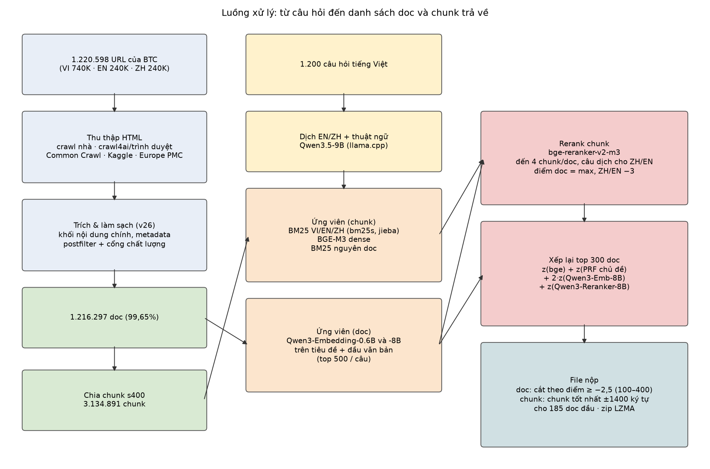

# Thuyết minh sản phẩm – Đội IComeForFood

R2AI 2026 · Stage 3 · Truy hồi tài liệu y khoa đa ngôn ngữ với truy vấn tiếng Việt (ViBioMIR)

## 1. Tổng quan hệ thống

### 1.1 Phương pháp

Hệ thống là một pipeline truy hồi nhiều tầng. Mọi mô hình đều là mô hình mở, không quá 15B tham số, phát hành trước 01/08/2026, chạy cục bộ; không dùng API đóng ở bất kỳ bước nào.

1. **Xây kho văn bản.** Thu thập nội dung cho 1.220.598 URL của BTC, trích phần nội dung chính, làm sạch, gắn metadata. Kết quả là 1.216.297 doc (99,65% số URL): 737.911 doc tiếng Việt, 239.896 tiếng Anh (PubMed), 238.490 tiếng Trung.
2. **Phân đoạn.** Chia mỗi doc theo cấu trúc tiêu đề thành chunk khoảng 400 đơn vị, tổng cộng 3.134.891 chunk.
3. **Dịch câu hỏi.** Mỗi câu hỏi tiếng Việt được dịch sang tiếng Anh và tiếng Trung, kèm vài thuật ngữ y khoa chuẩn, bằng Qwen3.5-9B. Bản dịch dùng cho BM25 và reranker trên doc tiếng Anh và tiếng Trung.
4. **Tìm ứng viên** bằng hai nhóm:
   - **Mức chunk:** BM25 theo từng ngôn ngữ (truy vấn tiếng Việt cho kho tiếng Việt, bản dịch cho kho tiếng Anh và tiếng Trung), BGE-M3 dense, và BM25 trên nguyên doc. Các danh sách được gộp bằng RRF theo từng ngôn ngữ.
   - **Mức doc:** Qwen3-Embedding-0.6B và Qwen3-Embedding-8B mã hóa tiêu đề và phần đầu của mọi doc, rồi lấy 500 doc gần nhất với câu hỏi.
5. **Xếp hạng lại.**
   - bge-reranker-v2-m3 chấm từng cặp (câu hỏi, chunk). Mỗi doc trong top được chấm đến 4 chunk; doc tiếng Anh và tiếng Trung được chấm thêm bằng câu dịch, lấy điểm cao hơn. Điểm doc là điểm chunk cao nhất. Doc tiếng Anh và tiếng Trung bị trừ 3 điểm, vì đáp án thực tế nghiêng hẳn về doc tiếng Việt.
   - 300 doc đầu của mỗi câu được xếp lại theo tổng điểm chuẩn hóa z: z(bge) + z(PRF chủ đề) + 2·z(Qwen3-Embedding-8B) + z(Qwen3-Reranker-8B). PRF chủ đề là độ tương đồng cosine giữa vector doc (trung bình vector BGE-M3 các chunk của doc) và tâm của 20 doc đầu.
6. **Tạo kết quả.**
   - Số doc trả về thay đổi theo từng câu: giữ các doc có điểm bge (đã trừ điểm phạt) từ −2,5 trở lên, tối thiểu 100 và tối đa 400 doc, trung bình khoảng 261 doc. Lý do: F2 coi recall nặng hơn precision.
   - Với 185 doc đầu, đoạn trả về là chunk có điểm rerank cao nhất, mở rộng thêm 1.400 ký tự mỗi bên. Đoạn dài làm tăng khả năng đạt ngưỡng LCS ≥ 40% với đoạn tham chiếu.
   - File JSON được nén ZIP chuẩn LZMA với từ điển 256MB, để vừa giới hạn 100MB.

### 1.2 Sơ đồ luồng xử lý

### 1.3 Chỉ mục, truy hồi, xếp hạng lại và chọn kết quả

| Thành phần | Cách làm | Code |
|---|---|---|
| Chỉ mục BM25 chunk | `bm25s`, k1 = 1,5, b = 0,75. Tiếng Việt: âm tiết đã chuẩn hóa và cặp âm tiết liền nhau (bigram); tiếng Trung: `jieba.lcut_for_search`; tiếng Anh: từ. Tối đa 300 token mỗi chunk | `retrieval/pipeline.py cands` |
| Chỉ mục BM25 nguyên doc | `HashingVectorizer` 2^23 chiều, BM25 (k1 = 1,5, b = 0,75) trên tiêu đề và toàn văn | `retrieval/sub3/bm25doc.py` |
| Chỉ mục dense chunk | BGE-M3 fp16, vector chuẩn hóa, lưu `dense.npy`. Tính tích vô hướng chính xác trên GPU (PyTorch), không xấp xỉ | `retrieval/pipeline.py encode`, `cands` |
| Truy hồi dense mức doc | Qwen3-Embedding mã hóa tiêu đề và 1.200 ký tự đầu (256 token) của 1,2 triệu doc. Câu hỏi có câu lệnh hướng dẫn; giữ top 500 mỗi câu | `retrieval/sub3/qemb.py` |
| Gộp ứng viên | RRF (k = 60) các danh sách cùng ngôn ngữ; lấy 300 doc mỗi ngôn ngữ, mỗi doc 1 chunk tốt nhất | `retrieval/pipeline.py rerank` |
| Rerank | bge-reranker-v2-m3 (max_length 512, fp16). Thêm 3 chunk cho mỗi doc trong top 200 (chọn theo số từ trùng câu hỏi). Doc mới do Qwen3-Embedding tìm ra được chấm 2 chunk | `pipeline.py rerank`, `sub3/rerank_more.py` |
| Xếp lại top 300 | PRF chủ đề, cosine Qwen3-Embedding-8B, điểm Qwen3-Reranker-8B (logit "yes" − "no"), cộng theo z-score từng câu | `sub3/prf.py`, `sub3/qemb_pool.py`, `sub3/q8rr.py`, `sub3/combine_aux2.py` |
| Chọn doc và đoạn | Cắt theo điểm từng câu; đoạn là chunk tốt nhất ±1.400 ký tự cho 185 doc đầu; nén LZMA | `sub3/make_sub3.py`, `sub3/lzbig.py` |

Các lựa chọn trên được chọn qua khoảng 57 lần nộp ở vòng public. Một số kết quả chính:

| Thay đổi | Ảnh hưởng FINAL |
|---|---|
| Phủ corpus từ 32% lên 86%, rồi lên 99% | 0,063 → 0,155 → 0,198 |
| Trừ điểm doc tiếng Anh và tiếng Trung | 0,198 → 0,235 |
| Đoạn dài (±1 chunk, rồi ±1.400 ký tự) và nén bzip2/LZMA để gửi đoạn cho nhiều doc hơn | +0,03 |
| Thêm doc do Qwen3-Embedding tìm ra | DOCS F2 +0,018 |
| PRF chủ đề; cosine Qwen3-Embedding-8B khi xếp lại | DOCS F2 +0,006; +0,005 |
| Bài public tốt nhất | **0,2922** (DOCS F2 0,3312, CHUNKS F2 0,2531) |

Bài private bổ sung thêm doc do Qwen3-Embedding-8B tìm trên toàn kho, điểm Qwen3-Reranker-8B, và đoạn cho 185 doc thay vì 155.

## 2. Dữ liệu

### 2.1 Nguồn và cách thu thập

Nguồn duy nhất là danh sách URL của BTC (`links_corpus_vi_en_zh.parquet`). Đội không thêm tài liệu ngoài danh sách. Nội dung được lấy theo nhiều đường; khi một trang chặn truy cập thì đội dừng với trang đó, không đổi IP để lách.

| Đường thu thập | Số doc | Code |
|---|---|---|
| Crawl HTTP từ mạng gia đình, giới hạn tốc độ theo từng host, dừng khi bị chặn | 51.358 (`docs_home`, `docs_home1027`) | `crawl/crawl_home.py` |
| Crawl của thành viên thứ hai (requests, crawl4ai, trình duyệt cho trang dùng JavaScript), lưu shard HTML trên Drive | 709.517 (`docs_tv_drive_*`), 21.679 (`docs_tv_git*`), 65.289 (`docs_tv_drive_short`), 1.043 (`docs_tv_old`) | `crawl/` (`crawl_browser.py`, `longchau_*.py`, `vov.py`, …), `notebooks/01_data_pipeline.ipynb` |
| Common Crawl: tra chỉ mục CDX, tải đúng đoạn WARC của trang | 49.472 Long Châu (`docs_cc_longchau`), 1.810 trang khác (`docs_cc1029`) | `crawl/commoncrawl/` |
| Kaggle notebook (Internet của Kaggle) cho 120ask.com | 61.561 (`docs_120ask`) | `crawl/commoncrawl/make_120ask_notebook.py` |
| PubMed qua Europe PMC API (và NCBI efetch cho số ít) | 239.896 (`docs_pubmed_tv`) | `notebooks/04_pubmed_only.ipynb`, `notebooks/05_pubmed_rescue.ipynb` |
| zysjonline.com (bản dump công khai của trang) | 6.591 (`docs_zysjonline`) | `extract/zysjonline_dump.py` |
| VOV: trình duyệt Chrome chạy JavaScript | 8.081 (`docs_vov1030`) | `crawl/vov.py` |

Phần thiếu (0,35%, khoảng 4.300 URL) chủ yếu là trang đã bị xóa (thaythuocvietnam.vn chuyển hướng về trang chủ) hoặc trang chặn truy cập mà Common Crawl không lưu.

### 2.2 Làm sạch

- **Trích nội dung (bộ trích v26, `extract/v26/03_dbee143.py`, xuất từ `notebooks/03_gold_review_and_sample2.ipynb`).**
  - Đọc HTML, đoán bảng mã (gb18030 cho trang tiếng Trung), chọn khung nội dung chính theo gợi ý từng domain (`crawl/container_hints.csv`), tách thành các khối (tiêu đề, đoạn, danh sách, bảng, hỏi–đáp) có vai trò.
  - Bỏ menu, quảng cáo, "bài liên quan", bình luận, hộp đặt lịch… theo đặc tả `DAC_TA_LAM_SACH_v1.md`.
  - Ghi metadata: tiêu đề, ngày, chuyên mục, ngôn ngữ, SHA-1 văn bản.
  - Doc PubMed gồm tiêu đề, tóm tắt và metadata tạp chí.
- **Lọc sau (`extract/postfilter.py`):** bỏ khối rác còn sót theo luật từng domain.
- **Cổng chất lượng (`extract/cc_gate.py`):** loại trang rỗng, trang lỗi (404, "không tìm thấy trang"). Giữ trang ngắn dưới 400 ký tự, vì nhiều trang hỏi–đáp ngắn nhưng hợp lệ.
- **Gộp kho (`retrieval/sub3/assemble_*.py`):** mỗi id lấy một bản theo thứ tự ưu tiên nguồn; không trùng id.
- **Chất lượng bộ trích** được đo trên bộ chuẩn tay 40 trang × nhiều domain (`eval/score_extraction.py`, `eval/gold_tools.py`).

### 2.3 Phân đoạn (`chunking/chunker.py`, cấu hình `chunking/configs/s400.json`)

- Chia theo mục cấp 2: tiêu đề và thân, kể cả tiêu đề con. Mục dài quá 600 đơn vị thì chia đều thành các phần khoảng 400 đơn vị, chồng lấn 40 đơn vị; tối thiểu 60 và tối đa 1.500 đơn vị.
- Đơn vị là âm tiết với tiếng Việt và tiếng Anh, ký tự với tiếng Trung.
- Bỏ khối mục lục và khuyến cáo; khối tài liệu tham khảo thành chunk riêng.
- Mỗi chunk giữ `doc_id`, ngôn ngữ, đường dẫn tiêu đề, vị trí ký tự (`char_start`, `char_end`) trong văn bản doc. Đoạn trả về được cắt lại từ văn bản doc theo vị trí này.

### 2.4 Truy cập dữ liệu

Link Google Drive: **https://drive.google.com/drive/folders/14O6HPJAtQySitIAiEKx7NGCx0vEnExkV**, thư mục `r2ai_data/`, cùng cấu trúc mà code dùng (`R2AI_DATA`):

| Thư mục | Nội dung | Dung lượng |
|---|---|---|
| `raw/` | `query.parquet`, `links_corpus_vi_en_zh.parquet` của BTC | 37MB |
| `docs_sub2/`, `docs_sub3add/`, `docs_sub4add/`, `docs_sub5add/` | Doc đã làm sạch (parquet: `id`, `url`, `lang`, `title`, `text`, `blocks`, metadata) | 4,8GB |
| `chunks_sub*/s400/` | Chunk s400 (parquet) | 2,4GB |
| `qtrans/v1/translations.jsonl` | Bản dịch EN/ZH và thuật ngữ của 1.200 câu hỏi | 1,5MB |
| `runs/sub3/` | Kết quả trung gian của các mô hình: ứng viên, điểm rerank, điểm Qwen3-Embedding và Qwen3-Reranker, PRF | 143MB |
| `submissions/` | Bài private đã nộp, bài public tốt nhất (0,2922) | 172MB |

HTML gốc (dung lượng rất lớn; một phần có trong repo dưới dạng snapshot) không đưa lên Drive. Có thể tạo lại bằng các script crawl, nhưng nội dung web thay đổi theo thời gian, nên kho doc trên Drive là bản dùng cho bài nộp.

## 3. Mô hình sử dụng

| Mô hình | Vai trò | Định danh (Hugging Face) và revision | Phát hành, giấy phép | Cấu hình |
|---|---|---|---|---|
| Qwen3.5-9B (GGUF Q4_K_M) | Dịch câu hỏi VI → EN/ZH, thêm thuật ngữ | `Qwen/Qwen3.5-9B` @ `c202236235762e1c871ad0ccb60c8ee5ba337b9a`, lượng tử hóa Q4_K_M chạy bằng llama.cpp `llama-server` | 27/02/2026, Apache-2.0 | Prompt và JSON schema trong `retrieval/translate_queries.py` |
| BGE-M3 | Embedding chunk, truy hồi dense; vector doc cho PRF | `BAAI/bge-m3` @ `5617a9f61b028005a4858fdac845db406aefb181` | 01/2024, MIT | fp16, max_length 512 |
| bge-reranker-v2-m3 | Rerank (câu hỏi, chunk) | `BAAI/bge-reranker-v2-m3` @ `953dc6f6f85a1b2dbfca4c34a2796e7dde08d41e` | 03/2024, Apache-2.0 | fp16, max_length 512 |
| Qwen3-Embedding-0.6B | Truy hồi dense mức doc | `Qwen/Qwen3-Embedding-0.6B` @ `97b0c614be4d77ee51c0cef4e5f07c00f9eb65b3` | 06/2025, Apache-2.0 | fp16, 256 token, last-token pooling, câu lệnh trong `qemb.py` |
| Qwen3-Embedding-8B | Truy hồi dense mức doc; cosine khi xếp lại | `Qwen/Qwen3-Embedding-8B` @ `1d8ad4ca9b3dd8059ad90a75d4983776a23d44af` | 06/2025, Apache-2.0 | fp16; lượt chấm top 300 chạy NF4 4-bit (bitsandbytes) vì GPU dùng chung |
| Qwen3-Reranker-8B | Chấm lại top 300 doc | `Qwen/Qwen3-Reranker-8B` @ `77d193c791ed757ca307ee72715aa132723da912` | 05/2025, Apache-2.0 | fp16, max_length 512, prompt trong `retrieval/pipeline.py` (`Qwen3Reranker`) |

Tải về: `huggingface-cli download <định danh> --revision <revision>`, hoặc để `transformers` tự tải khi chạy. Không có checkpoint nào được tinh chỉnh; đội chỉ dùng trọng số gốc. Thư viện phụ trợ: `jieba` 0.42.1 (tách từ tiếng Trung), `bm25s` 0.3.15.

Không dùng mô hình nào trong danh sách loại trừ: không có LLM đóng, không có mô hình lớn hơn 15B.

## 4. Mã nguồn và hướng dẫn chạy lại

Xem `README.md` trong gói mã nguồn: danh sách thư mục, thư viện và phiên bản, lệnh tạo lại bài nộp từ dữ liệu trên Drive (chỉ cần CPU), và lệnh chạy toàn bộ pipeline từ đầu (cần GPU).

Bài private có thể tạo lại đúng nội dung từ kết quả trung gian trên Drive: chạy `retrieval/sub3/reproduce_submission.sh` cho ra file trùng 1.200/1.200 câu (cả danh sách doc lẫn đoạn trả về) với bài đã nộp.
